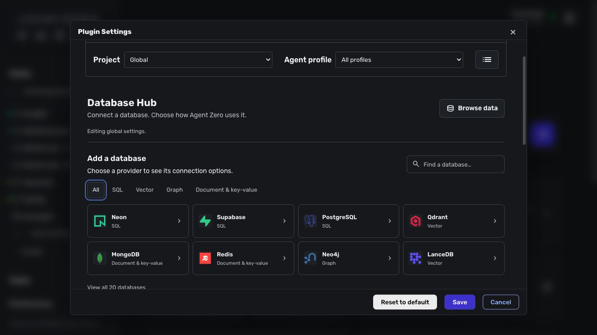
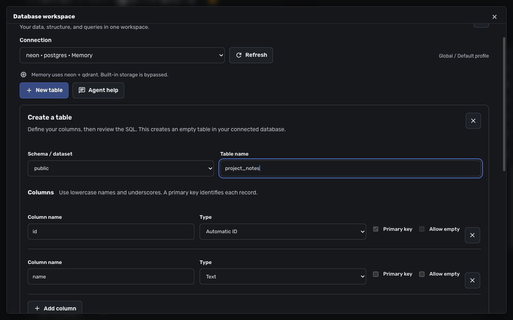

# Database Hub


Connect Agent Zero to named databases for data exploration, queries, table creation, or optional agent memory. Connections can be scoped to a project and agent profile. Browsing a database does not make it a memory destination.

- Browse SQL, vector, graph, document and key-value stores in one workspace.
- Inspect schemas and relationships, create tables, and review record changes before applying them.
- Give agents nine database and memory tools, with saved connection permissions enforced server-side.
- Optionally replicate agent memory to multiple selected stores, with automatic recall and scoped storage.



## Compatibility

**Verified with [Agent Zero v2.14](https://github.com/agent0ai/agent-zero/releases/tag/v2.14)** (`ff2a5b9c9c4e490ba38dd7c313e779510bb2071a`). Database memory requires the user-plugin precedence fix from [PR #1943](https://github.com/agent0ai/agent-zero/pull/1943), which is included in that release. No manual core patch is required.

DB Hub checks the actual tools and lifecycle hooks selected for the current scope. Incompatible cores or overriding agent profiles cannot enable database memory. An existing database-memory configuration also stops the monologue with an actionable error instead of silently writing to built-in storage. Ordinary database tools and the workspace remain available with database memory off.

Keep the built-in **Memory** plugin enabled: it supplies recall settings, prompts, and behavior rules. DB Hub replaces its storage when selected, including manual memory tools, automatic recall, and background memorization.

## Install and connect

SpacetimeDB query/reducer support starts at 1.1.0; 1.2.0 adds full Agent Zero memory support, and **1.3.0 adds identity/token creation directly in settings**. See the [SpacetimeDB setup guide](docs/spacetimedb.md) for connection and memory preparation. Older release ZIPs do not include these additions.

1. Open **Plugins → Install** and use the repository URL `https://github.com/TerminallyLazy/a0-db-hub`, or upload `db-hub-1.0.0.zip` from the [v1.0.0 release](https://github.com/TerminallyLazy/a0-db-hub/releases/tag/v1.0.0). Then enable **Database Hub**. Its install hook prepares the common PostgreSQL, Qdrant, and Neo4j clients in the plugin's private dependency directory, using the framework Python runtime.
2. Open **Config**. Select the intended project/profile scope before editing.
3. Choose a database in **Add a database**. Neon and Supabase offer management-token project discovery and a provider-console fallback. Qdrant offers guided endpoint/API-key setup. A registered OAuth app is optional; no app credentials are included.
4. Enter the provider's connection URL or local database path. The converter accepts supported URLs, CLI snippets, and environment-variable snippets. Move passwords and API keys into Agent Zero Secrets when prompted; saved configuration uses `§§secret(KEY)` references.
5. **Test**, then **Save**. Testing a draft does not save it. Optional driver packages are installed on first use.

Use **Install drivers** in advanced settings to repair dependencies, then restart Agent Zero. DB Hub resolves its dependencies against installed framework versions, keeps the framework first in Python's import search, and replaces its private dependency directory as a complete set. Failed resolution preserves the previous installation. Plugin-owned packages are not a separate Python interpreter.

DB Hub is open source and includes no database accounts or provider credentials. Hosted databases, embedding models and utility models may incur charges from their providers. Local database drivers need local storage; initial installation and optional-driver setup require internet access and can download substantial dependencies. Provider verification varies; see the [support matrix](docs/support.md) before choosing an integration.

## Explore databases and create tables

Open **Browse data** from settings or **Open** on the plugin card. Choose a saved connection and a resource from the schema/collection tree.



- **Data:** paged records, supported native filters/sorting, and reviewed record changes where the provider exposes a usable identity.
- **Structure:** columns, types, keys, indexes, collection settings, and vector dimensions where available.
- **Visualizer:** provider-reported relational foreign keys or supported graph topology, with pan/zoom, filtering, layout persistence, and SVG export. Relationships are not inferred for vector collections.
- **Query:** bounded SQL, Cypher, or native provider operations. Saved permissions remain authoritative. PostgreSQL read-only queries can be cancelled.
- **New table:** guided SQL table creation, columns, supported defaults and primary keys, followed by review of the exact generated statement. It does not replace an existing table. Advanced relationships/DDL use Query.
- **Agent help:** copy a prompt containing the current connection, resource, and scope so Agent Zero can explain a schema, propose a query, or help design a table. Review changes before applying them.

Support varies by driver. See the [provider support matrix](docs/support.md), including fixture-only and experimental integrations.

## Agent memory

Enable **Use database for memory**, select one or more writable supported connections, and **Save**. PostgreSQL/Neon/Supabase with pgvector, Qdrant, LanceDB, ChromaDB, and prepared SpacetimeDB implement automatic memory storage. With a single SpacetimeDB connection awaiting storage, turning on the switch opens its memory setup and selects it in the draft. **Set up memory** also opens that setup directly. Finish preparation, Test, then Save to activate memory. The toggle is a draft until Save; leaving settings first discards the change.

Save prepares and validates three areas inside each selected memory database: `{prefix}_main`, `{prefix}_fragments`, and `{prefix}_solutions`. PostgreSQL needs permission to use pgvector and create the required tables. In SpacetimeDB's **Agent memory storage**, use **Create identity and store token** for first-time setup, choose **Read & write**, then **Review new storage → Create private database**. The token goes directly to scoped Agent Zero Secrets; settings receive only its reference. Existing memories require their original token and a database with the shipped memory module. Creation uses a separate database on the same server and can consume provider quota; the application module is preserved. Test, select the connection, then Save. A failed setup does not save the configuration, although storage already created is retained. No CLI or Docker Terminal plugin is required for this flow.

- Writes replicate to every selected destination with a shared memory ID; reads merge and deduplicate results.
- Store failures are reported. DB Hub does not silently fall back to FAISS.
- Recall thresholds, intervals, query preparation, and background-learning switches remain in the built-in Memory settings.
- Project/custom memory isolation follows Agent Zero's configured memory-directory rules and adds a stable suffix where required. An agent profile alone does not necessarily imply a separate store; use distinct memory directories or prefixes when separation is required.
- Turn database memory off and Save to restore built-in storage. Previously stored external memories are retained.
- Existing FAISS memories are not automatically copied. The explicit `db_memory_migrate` tool copies them for the chosen scope and re-embeds text without deleting the originals.
- **Memory storage & verification** tests saved settings with a synthetic write, search, and deletion. The standard Memory dashboard still shows the built-in store; inspect external memory in DB Hub's workspace.

Background learning summarizes conversations using the configured utility model. It replaces sufficiently similar memories according to the replacement threshold; it does not reproduce the built-in store's full consolidation behavior.

## Agent tools

| Tool | Purpose |
| --- | --- |
| `db_status` | Check saved database connections |
| `db_schema` | Discover tables, collections, indexes, or graph metadata |
| `db_query` | SQL, Cypher, or provider-native operations |
| `db_vector` | Vector search/upsert/delete; text search uses the configured embedding model |
| `db_memory_migrate` | Explicitly copy built-in memories to the selected destinations |
| `memory_save`, `memory_load`, `memory_delete`, `memory_forget` | Use selected database memory, or delegate when database memory is off |

## Authentication and permissions

Registered-app flows exist for Neon, Supabase, Google BigQuery, Snowflake, and Convex. Configured identity-provider flows exist for Neo4j, MongoDB, and self-hosted Weaviate. These require the corresponding provider/IdP app, callback, scopes, and database roles. Generic account sign-in does not grant database access. Real OAuth sign-in has not been certified for every provider; token/console setup remains available. Supabase project discovery still requires the existing database password, and Neon OAuth requires approved partner credentials.

Connections default to read-only. A tool can request stricter access, but **cannot override a saved read-only setting**. Writable workspace operations require explicit review bound to the session, scope, connection, and proposed change. SQL record edits require suitable keys; vector providers cannot guarantee atomic compare-and-swap against concurrent outside writers.

Read-only SQL/Cypher rejects command batches, comments, mutating clauses and unrecognized procedures. The classifier is conservative: bind literal text as parameters if it contains reserved words or semicolons. Use database credentials with read-only roles for a database-enforced boundary, especially when exposing custom functions; query classification cannot determine the side effects of arbitrary server functions.

Resolved credentials are kept server-side; known credential slots require Secret references, and tool/API errors are masked. Custom driver options and returned database content still require review: query results are untrusted input, and broad database roles remain broad even when an editor asks for confirmation.

## Uninstall and release packaging

Uninstall closes connection pools and removes DB Hub-owned dependency directories. It does not delete external databases, tables, memories, or Agent Zero Secrets. Review and remove no-longer-needed secrets separately.

Build a deterministic, source-only release from the plugin directory:

```sh
python scripts/package.py /tmp/db-hub.zip
```

The builder includes an explicit set of source paths and writes a SHA-256 manifest. It excludes saved configuration, activation markers, secrets, dependencies, caches, and local database files. Do not zip an installed plugin directory wholesale.

The separate [a0-plugins](https://github.com/agent0ai/a0-plugins) entry points to this repository. Catalog availability depends on maintainer review; repository and release installation work independently of the Index. See [release verification](docs/release.md) for acceptance boundaries.

## Development and verification

Run Python checks from an Agent Zero v2.14 checkout with this plugin installed under `usr/plugins/db_hub`, using the **framework** interpreter and the plugin's test dependencies:

```sh
cd /a0
/opt/venv-a0/bin/python -m pytest -q usr/plugins/db_hub/tests tests/test_plugin_asset_precedence.py
node --test usr/plugins/db_hub/tests/*.test.mjs
```

The local database fixtures require SQLAlchemy, ChromaDB, LanceDB and DuckDB in addition to the base drivers. Run the JavaScript checks from the standalone repository with `node --test tests/*.test.mjs`; the full Python and memory-routing results are recorded in the release verification document. The screenshots show provider selection and a sample table definition, with no credentials or database records.
